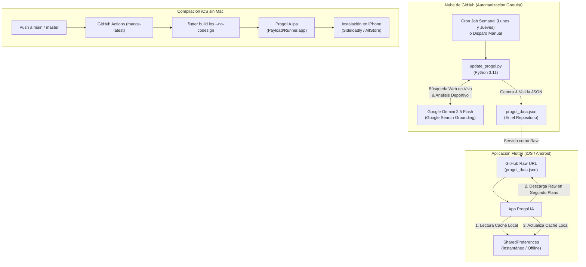

# ⚽ Progol IA — Pronósticos Inteligentes para Quinielas Oficiales

**Progol IA** es una aplicación móvil moderna, minimalista y ultra-rápida desarrollada en **Flutter** para iOS y Android, diseñada para consultar las quinielas oficiales de México: **Progol** (14 partidos de fin de semana) y **Progol Media Semana** (9 partidos intersemanales), acompañadas de pronósticos de alta precisión generados por Inteligencia Artificial (**Google Gemini 2.5 Flash con búsqueda web / Google Search Grounding**).

---

## 🏛️ Arquitectura del Sistema (100% Gratuito y Serverless)

El proyecto utiliza una arquitectura desacoplada sin necesidad de servidores dedicados ni bases de datos de pago:



---

## 📱 Características de la Interfaz (UI/UX Minimalista)

- **Modo Oscuro Nativo**: Diseñado desde cero con una paleta oscura moderna (`#0B0F14`), tarjetas de alto contraste y tipografía nítida (*Outfit* e *Inter*).
- **Dos Pestañas (TabBar)**:
  - **Progol**: Los 14 partidos del concurso de fin de semana.
  - **Media Semana**: Los 9 partidos del concurso intersemanal.
- **Tarjetas Limpias y Sin Ruido**:
  - Número de partido oficial (`#1`, `#2`, ...).
  - Equipos: **Local vs Visita**.
  - **Insignia Visual Destacada de Pronóstico**:
    - `[ L ]` **Verde Esmeralda** (`#10B981`) para Local.
    - `[ E ]` **Ámbar Cálido** (`#F59E0B`) para Empate.
    - `[ V ]` **Azul Deportivo** (`#3B82F6`) para Visita.
- **Sincronización en 1 Toque y Pull-to-Refresh**: Desliza hacia abajo o pulsa el botón de refresco para obtener la información más reciente de la semana.
- **Modo 100% Offline**: Si no tienes conexión a internet, la aplicación sigue funcionando cargando la última quiniela guardada en la memoria del dispositivo.

---

## 📂 Estructura del Proyecto

```
progol_ia/
├── .github/
│   └── workflows/
│       ├── update_data.yml     # Cron job (Lunes y Jueves) + Gemini IA + auto-commit
│       └── build_ios.yml       # Compilación de ProgolIA.ipa en runner macOS sin Mac física
├── assets/
│   └── progol_data.json        # Datos base iniciales empaquetados en la app
├── lib/
│   ├── main.dart               # Punto de entrada de la aplicación y configuración de tema
│   ├── models/
│   │   └── quiniela_model.dart # Modelos de datos Partido, Quiniela y ProgolDataResponse
│   ├── services/
│   │   └── progol_service.dart # Sincronización con GitHub Raw + Caché con SharedPreferences
│   ├── theme/
│   │   └── app_theme.dart      # Paleta oscura, tipografía y colores de predicción (L, E, V)
│   ├── views/
│   │   └── home_screen.dart    # Pantalla principal con TabBar, listas limpias y Pull-to-Refresh
│   └── widgets/
│       ├── match_card.dart     # Tarjeta minimalista de cada encuentro
│       ├── settings_dialog.dart# Ajuste de URL del repositorio y estado de conexión
│       └── status_header.dart  # Resumen de concurso, semana y balance (L - E - V)
├── scripts/
│   └── update_progol.py        # Extracción y predicción con Gemini 2.5 Flash + Google Search
├── test/
│   └── widget_test.dart        # Pruebas unitarias de modelos y deserialización
├── ios/                        # Estructura nativa de iOS lista para compilar
├── android/                    # Estructura nativa de Android
├── progol_data.json            # Archivo raíz servido directamente por GitHub Raw
└── pubspec.yaml                # Dependencias oficiales de Flutter
```

---

## 🤖 Script de Automatización con IA (`update_progol.py`)

El script consulta el modelo `gemini-2.5-flash` con la herramienta `google_search` activada. Esto permite:
1. Buscar en tiempo real los 14 partidos activos de **Progol** y los 9 de **Progol Media Semana** publicados por Pronósticos / Lotería Nacional de México.
2. Analizar el rendimiento reciente de ambos equipos, posición en la tabla general, récord local/visitante, bajas y enfrentamientos directos.
3. Asignar de forma justificada el pronóstico más probable (`L`, `E` o `V`).
4. Generar estrictamente un JSON normalizado y guardarlo en `progol_data.json`.

---

## ⚙️ Guía de Configuración en GitHub

### 1. Obtener la API Key Gratuita de Google Gemini
1. Ingresa a [Google AI Studio](https://aistudio.google.com/).
2. Haz clic en **"Get API key"** y crea una clave gratuita.

### 2. Configurar el Secreto en tu Repositorio de GitHub
1. En tu repositorio de GitHub, entra a **Settings** > **Secrets and variables** > **Actions**.
2. Haz clic en **New repository secret**.
3. Nombre del Secreto: `GEMINI_API_KEY`
4. Valor: Tu clave generada en Google AI Studio.
5. Haz clic en **Add secret**.

### 3. Habilitar Permisos de Escritura para GitHub Actions
Para que el workflow pueda hacer `git push` automáticamente de `progol_data.json`:
1. Ve a **Settings** > **Actions** > **General**.
2. En la sección **Workflow permissions**, selecciona **Read and write permissions**.
3. Haz clic en **Save**.

### 4. Probar la Actualización Manual
1. Ve a la pestaña **Actions** en tu repositorio de GitHub.
2. Selecciona el workflow **"Actualizar Quinielas Progol IA"**.
3. Haz clic en **Run workflow** > **Run workflow**.
4. En menos de 1 minuto, `progol_data.json` se actualizará con los partidos y pronósticos de la semana.

---

## 🍏 Instalación en iPhone sin Mac (Sideloadly / AltStore)

No necesitas tener una computadora Mac ni pagar una cuenta de desarrollador de Apple ($99 USD/año):

1. **Obtener el instalador `.ipa`**:
   - Cada vez que hagas `git push` a `main`, el workflow `.github/workflows/build_ios.yml` se ejecutará automáticamente en un runner de macOS en la nube.
   - Entra a la pestaña **Actions** > selecciona la última ejecución de **"Build iOS IPA (Sin Mac)"**.
   - Al final de la página, en la sección **Artifacts**, descarga el archivo comprimido **`ProgolIA-iOS-IPA.zip`** y extráelo para obtener `ProgolIA.ipa`.

2. **Instalar en tu iPhone con Sideloadly (Windows o Mac)**:
   - Descarga e instala [Sideloadly](https://sideloadly.io/) en tu PC con Windows.
   - Conecta tu iPhone a la PC mediante cable USB.
   - Arrastra el archivo `ProgolIA.ipa` dentro de la ventana de Sideloadly.
   - Ingresa tu Apple ID (cuenta gratuita personal de Apple) y presiona **Start**.
   - En tu iPhone, ve a **Ajustes** > **General** > **Administración de dispositivos y VPN** y confía en el certificado de tu Apple ID.
   - ¡Listo! Abre **Progol IA** en tu iPhone.

---

## 📲 Configurar la URL de tu Repositorio en la App

Por defecto, la app puede consultar cualquier URL de GitHub Raw. Para apuntar a tu propio repositorio:
1. Abre **Progol IA** en tu teléfono o emulador.
2. Toca el ícono de ajustes (engranaje) en la esquina superior derecha.
3. Ingresa tu URL:
   `https://raw.githubusercontent.com/<TU_USUARIO_GITHUB>/<NOMBRE_REPO>/main/progol_data.json`
4. Pulsa **Guardar y Sincronizar**. Tu configuración quedará guardada de forma permanente en el dispositivo.
